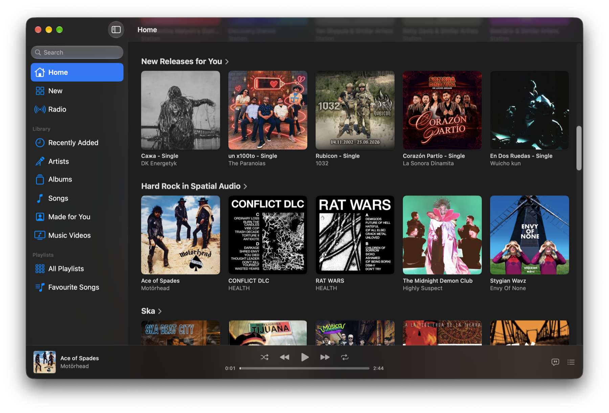

<p align="center">
  
</p>

<h1 align="center">CMusic</h1>

<p align="center">
  <strong>A fast, native Apple Music client for macOS.</strong><br>
  CMusic (Csimple Music) is a lightweight SwiftUI + MusicKit app that streams your Apple Music library, playlists and recommendations, built to scroll smoothly and open instantly.
</p>

<p align="center">
  <a href="https://github.com/ConstantineMalynin/CMusic/releases/latest"></a>
  
  
  <a href="LICENSE"></a>
</p>

<p align="center">
  
</p>

## Why CMusic?

The built-in Music app does a lot, and it can feel heavy doing it. CMusic does one thing: play Apple Music on your Mac **fast**. It has the same catalog and library and keeps your recommendations, with an interface tuned so grids of artwork scroll without stutter and pages appear without spinners.

- ⚡ **Fast by design.** Artwork is decoded off the main thread, cached in memory and on disk, and prefetched ahead of scrolling.
- 🍎 **Native.** Pure SwiftUI and MusicKit. No Electron, no web views, no background services.
- 🎧 **Your real Apple Music.** Signs in with your existing Apple Music subscription. Your library, playlists and listening history stay in sync.
- 🪶 **Small and focused.** About 2,000 lines of Swift you can read in an afternoon.

## Features

- **Discover:** Home with personal recommendations and Recently Played, New releases, and Radio stations
- **Library:** Recently Added, Artists, Albums, Songs, Made for You, Music Videos
- **Playlists:** all your library playlists in the sidebar
- **Search** for songs across the Apple Music catalog
- **Player bar:** play/pause, next/previous, shuffle, repeat and a scrubber that seeks on release
- **Autoplay:** when the queue runs out, a station based on the last song keeps the music going (toggle with ∞)
- **Sortable song lists:** double-click any row to play from there
- **Menu bar controls and keyboard shortcuts**, matching Music.app:

  | Action | Shortcut |
  | --- | --- |
  | Play / Pause | <kbd>Space</kbd> |
  | Next track | <kbd>⌘</kbd> <kbd>→</kbd> |
  | Previous track | <kbd>⌘</kbd> <kbd>←</kbd> |

## How it stays fast

CMusic's speed comes from a handful of deliberate choices, not from cutting features:

| Technique | What it avoids |
| --- | --- |
| Two-level artwork cache (256 MB memory, 512 MB disk) | Re-downloading and re-decoding artwork, even across launches |
| Artwork sizes snapped to fixed buckets | New network requests every time a grid resizes |
| Prefetching artwork for tiles just past the visible edge | Placeholders appearing while you scroll |
| Nine-slice cached bitmap shadows instead of SwiftUI `.shadow` | One offscreen render pass per tile, which dominates frame time in large grids |
| Precomputed grid tile widths | Every tile measuring itself on layout |
| Playback time isolated in its own view | Re-rendering the whole player bar twice a second |
| Song sorting cached outside `body` | Re-sorting thousands of rows on every view update |

## Download

1. Grab the latest `CMusic.dmg` from **[Releases](https://github.com/ConstantineMalynin/CMusic/releases/latest)**.
2. Drag **CMusic** into your Applications folder.
3. Open it and allow access to Apple Music when asked.

Releases are signed with a Developer ID and notarized by Apple, so they open without Gatekeeper warnings.

### Requirements

- macOS 27 or later
- An active [Apple Music](https://www.apple.com/apple-music/) subscription

## Build from source

You need **Xcode 27** and a **paid Apple Developer account**, because Apple only lets apps registered for the MusicKit service play music.

1. Clone the repo:
   ```sh
   git clone https://github.com/ConstantineMalynin/CMusic.git
   cd CMusic
   open CMusic.xcodeproj
   ```
2. In **Signing & Capabilities**, choose your team and change the bundle identifier to one you own.
3. In the [Apple Developer portal](https://developer.apple.com/account/resources/identifiers/list), open that App ID, go to **App Services** and enable **MusicKit**.
4. Build and run (<kbd>⌘</kbd> <kbd>R</kbd>).

### Project layout

```
CMusic/
├── CMusicApp.swift          # App entry point and Controls menu
├── Music/                   # MusicKit services, player model, artwork loading
└── Views/                   # Sidebar, browse, library and player bar views
    └── Components/          # Shelves, artwork tiles, cached shadows
```

## Contributing

Issues and pull requests are welcome. If you're changing something on a hot path (scrolling grids, artwork, the player bar), please mention how you checked it still performs, for example with Instruments.

## License

CMusic is released under the [MIT License](LICENSE).

---

<sub>CMusic is an independent project and is not affiliated with, endorsed by or sponsored by Apple Inc. Apple Music, MusicKit and macOS are trademarks of Apple Inc. Album artwork shown in screenshots belongs to its respective owners.</sub>
